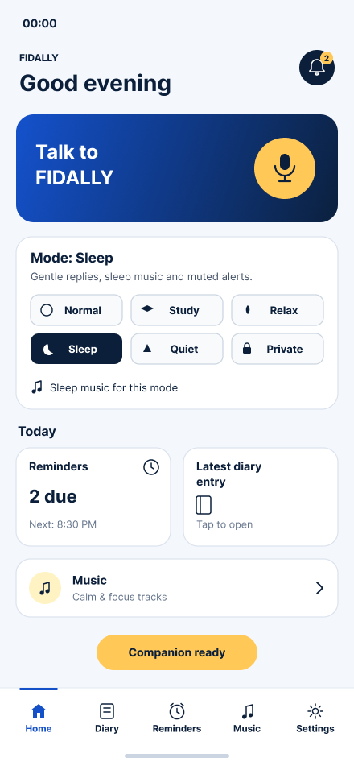
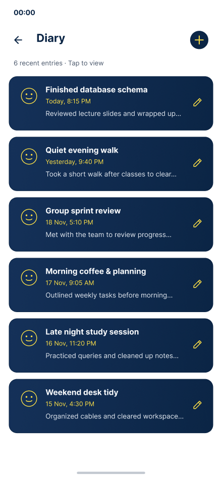
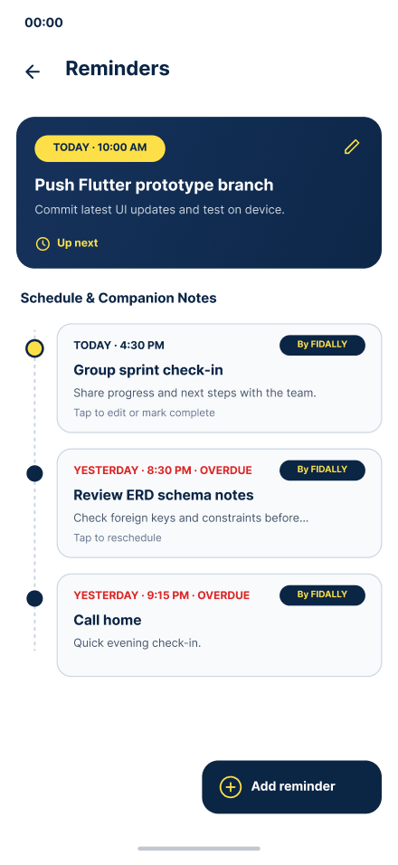
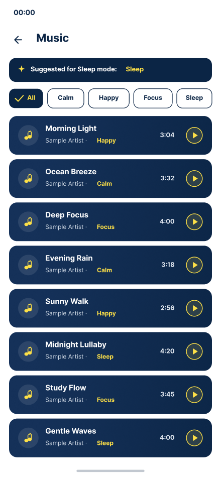

# FIDALLY — Companion Mobile Application (`Mobile-App`)

The **FIDALLY** companion mobile application is a cross-platform **Flutter (Dart)** application built in **Android Studio** that pairs with the physical FIDALLY AI companion device (Raspberry Pi 5). It serves as the primary control hub for reviewing user-approved diary entries, managing reminders, switching companion modes, selecting offline music tracks, and controlling local privacy settings.

---

## Interactive Prototype

* **Figma High-Fidelity Prototype:** [Open Interactive Figma Prototype](https://www.figma.com/design/aSx7zBmBW8T078qyYPaOkb/FIDALLY?node-id=64-239&t=L0br0kE5YXJLdcch-1)

---

## Application Screens Overview

The UI/UX design evolved from low-fidelity structural wireframes into an 11-screen high-fidelity prototype organized around clear card grouping, accessible touch targets, and local-first privacy controls:

| # | Screen | Purpose & Key Features |
| :--- | :--- | :--- |
| 1 | **Welcome** | Branded entry screen introducing FIDALLY and launching first-time onboarding |
| 2 | **Registration (Step 1)** | Collects user account credentials (full name, email, country, phone number, date of birth, and password) |
| 3 | **Registration (Step 2)** | Captures emergency contact details, links the physical companion via unique IMEI/barcode (with barcode scanning), records purchase date, and confirms privacy consent. |
| 4 | **Device Status & Pairing** | Displays companion connection state, battery level, owner details, masked Device ID, firmware version, last sync timestamp, and actions (`Sync now`, `Disconnect`, `Remove device`) |
| 5 | **Home Dashboard** | Central hub featuring companion status, interactive **Mode** selector (`Normal`, `Study`, `Relax`, `Sleep`, `Quiet`, `Private`), quick-access summary cards, and a 5-tab bottom navigation bar |
| 6 | **Talk** | Companion conversation interface supporting voice-assisted interaction and pending action review. |
| 7 | **Diary** | Chronological view of user-approved conversation summaries and manual journal entries with mood tagging (`Happy`, `Calm`, `Loved`, `Sad`, `Angry`, `Anxious`), editing, and deletion |
| 8 | **Reminders** | Lists voice-created and manual reminders with due times, completion toggles, and creation/editing modals |
| 9 | **Music** | Mood-filtered player (`All`, `Calm`, `Happy`, `Focus`, `Sleep`) controlling the 10 offline royalty-free tracks stored on the companion device |
| 10 | **Notifications** | Alert centre for device pairing confirmations, due reminders, and **memory approval requests** requiring explicit user consent before saving |
| 11 | **Settings** | Profile management, device pairing shortcut, granular notification toggles, and local-first privacy controls (`Stored on this device`, `Auto-delete my data` retention period, and `Delete all my data`) |

## **Screenshots**

  
  
  
  

---
